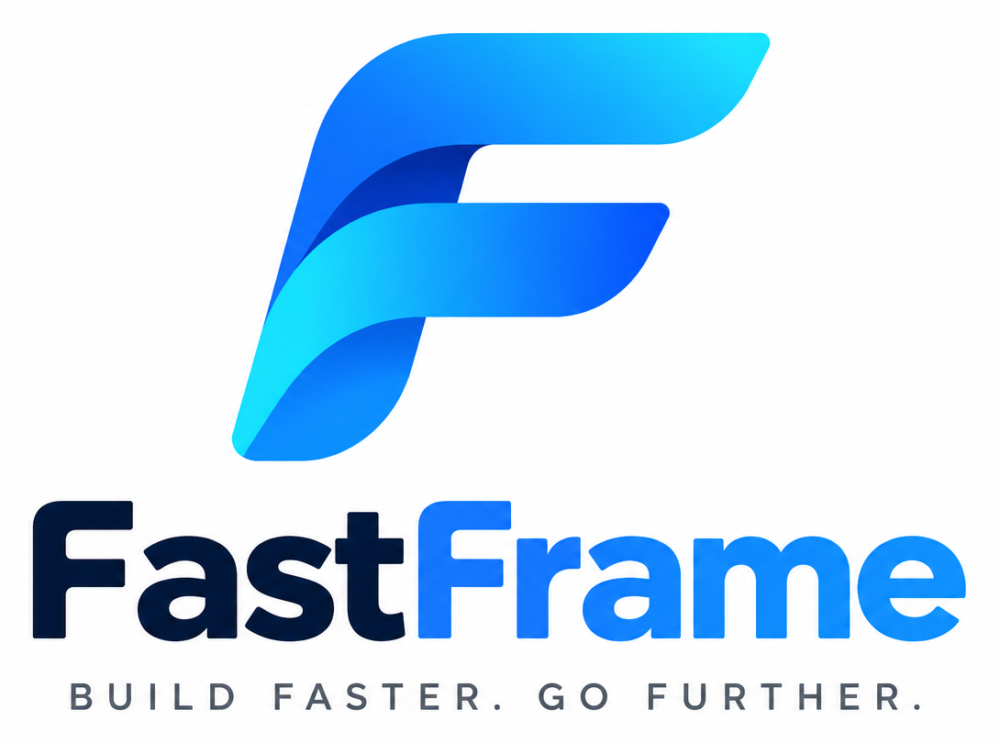

## FastFrame v0.22 — five benchmark suites

The new **Async I/O & JWT** benchmark joins Concurrency Scaling, Target RPS/p99,
JSON Sizes, and PostgreSQL/Redis. It compares FastFrame, Micronaut and Laravel Octane
using actual outbound HTTP calls with 10/50/200 ms upstream latency and real HS256
signature validation; see [benchmarks/ASYNC_JWT.md](benchmarks/ASYNC_JWT.md).

```bash
python3 benchmarks/async_jwt.py --frameworks fastframe micronaut laravel \
  --cases async_10 async_50 async_200 jwt --duration 30s \
  --warmup 5s --concurrency 64 --repeats 3
```

<div align="center">



# FastFrame

**A Laravel-inspired, modular Java framework built on Netty.**

Build readable REST APIs with compile-time routing, dependency injection, validation, database tools, queues, and optional infrastructure integrations — while keeping control over HTTP performance and memory use.

**Java 21** · **Netty 4.2** · **Maven** · **Windows / Linux / macOS**

[Getting started](#getting-started) · [Features](#features-at-a-glance) · [Examples](#write-your-first-controller) · [Benchmarks](#performance-and-benchmarks) · [Documentation](#documentation)

</div>

> [!IMPORTANT]
> **Status: v0.22.0-SNAPSHOT — experimental.** FastFrame is an evolving prototype, **not production-certified**. Security, compatibility and performance claims require independent validation. Some integrations need external services, and a complete cross-platform Maven/integration test pass has not been independently confirmed for this source snapshot.

## Why FastFrame?

FastFrame is designed around a straightforward idea: **the developer experience of Laravel, using Java's type system and an explicit high-performance HTTP stack**.

- **Familiar conventions:** annotated controllers, request DTOs, middleware, repositories, migrations and Artisan-inspired code generators.
- **Compile-time wiring:** an annotation processor generates routes, constructor-injection code and supported record DTO bindings. Controller discovery does not rely on per-request reflection.
- **Fast-path awareness:** synchronous routes avoid unnecessary future allocations; v0.21 can encode supported JSON response values directly to UTF-8.
- **Modularity:** include only the components you use. Redis, S3, testing and other integrations are separate Maven modules.
- **Operational foundations:** request IDs, optional metrics, health endpoints, request limits, CORS and a graceful shutdown mechanism.

The benchmark suite supports FastFrame, Micronaut, and Laravel 13 (Octane + FrankenPHP or dev server). The benchmark runner handles macOS TCP `TIME_WAIT` between sequential server launches and records actual ports in results. The project aims to be competitive with mature frameworks such as Micronaut, **not to claim it is currently faster**. Workload, hardware and JVM settings determine real results.

## Features at a glance

| Area | Available in this prototype | Module / detailed guide |
| --- | --- | --- |
| HTTP / routing | Netty HTTP/1.1, route parameters, grouped routes, sync/async handlers, middleware | `framework-core`, `framework-netty` |
| Compile-time tooling | `@Controller`, `@Get`, `@Post`, generated route registration, constructor DI and record DTO binding | `framework-processor` |
| Validation / JSON | `@Body`, `@Required`, `@Size`, `@Min`, `@Max`, 400 / 415 / 422 error handling, UTF-8 serialization | `framework-core`, [performance](PERFORMANCE.md) |
| Database | JDBC Query Builder, parameterized CRUD and transactions | `framework-database`, [database](DATABASE.md) |
| ORM / migrations | Java record models, generated mappers, repositories, versioned SQL migrations | `framework-orm`, `framework-migrations`, [ORM guide](ORM_MIGRATIONS.md) |
| Auth | HS256 Bearer JWT, password hashing, roles and permissions | `framework-auth`, [authorization](AUTHORIZATION.md) |
| Cache | Bounded in-memory TTL/LRU cache; optional Redis adapter | `framework-cache`, `framework-cache-redis`, [cache](CACHE.md) |
| Jobs / scheduling | Delayed jobs, retry/backoff, Redis-backed workers, cron scheduling | `framework-queue`, `framework-queue-redis`, [queues](QUEUE_SCHEDULER.md) |
| Storage / HTTP client | Bounded local files, optional S3, JDK asynchronous HTTP client | `framework-storage`, `framework-storage-s3`, `framework-http-client`, [storage](STORAGE_HTTP.md) |
| App lifecycle | Service providers, events and lifecycle hooks | `framework-application`, `framework-events`, [bootstrap](BOOTSTRAP_EVENTS.md) |
| Developer tooling | Code generation (`make:*`), compile-time `route:list`, `.env` config | `framework-cli`, `framework-config`, [CLI](CLI.md), [config](CONFIG.md) |
| Testing | HTTP feature tests, JSON assertions, H2 fixtures, HTTP mocks | `framework-testing`, [testing](TESTING.md) |
| Operations / security | Health checks, request IDs, metrics, security headers, CORS, local rate limiting | `framework-observability`, `framework-security`, [observability](OBSERVABILITY.md), [security](SECURITY.md) |

> These APIs are **FastFrame's own implementations inspired by Laravel concepts**, not a Laravel compatibility layer or a drop-in replacement for Spring/Micronaut.

## Getting started

### Requirements

- **JDK 21** (`java` and `javac`), e.g. Eclipse Temurin.
- **Maven 3.9+** to build the multi-module project.
- **Windows PowerShell 5.1+ / PowerShell 7** on Windows; a shell on Linux/macOS.
- Optional: Python 3.10+, [`hey`](https://github.com/rakyll/hey) for concurrency tests, and [k6](https://grafana.com/docs/k6/) for target-RPS tests; Redis for Redis-backed cache and queues.

### Windows 10/11 (PowerShell)

The scripts prefer the already configured JDK directory:

```text
C:\Program Files\Eclipse Adoptium\jdk-21.0.11.10-hotspot
```

**Java 8 may remain the global default** for existing applications: the included PowerShell scripts select Java 21 only for their own session and child processes.

```powershell
cd C:\xampp\www\fastframe

# If your policy blocks scripts, review them before enabling a session-only exception:
Set-ExecutionPolicy -Scope Process -ExecutionPolicy Bypass -Force

# Build, test, and start the demo at http://127.0.0.1:8080
.\scripts\run-demo.ps1
```

In **another** PowerShell window:

```powershell
curl.exe -i http://127.0.0.1:8080/api/health
curl.exe -i http://127.0.0.1:8080/_health/live
curl.exe -i http://127.0.0.1:8080/_health/ready
```

Expected `/api/health` JSON contains `"status":"ok"` (object field order is not guaranteed).

To build and verify without starting the server:

```powershell
mvn -B -ntp -pl demo-app -am clean verify
```

**Important for XAMPP users:** `C:\xampp\www` is typically an Apache document root. Keep secrets and uploaded files outside it; do not expose this checkout to the public internet. See [Windows setup](WINDOWS.md), [configuration](CONFIG.md), and [production guidance](PRODUCTION.md).

### Linux / macOS

```bash
mvn -B -ntp -pl demo-app -am clean verify
java -jar demo-app/target/demo-app-0.22.0-SNAPSHOT.jar
```

For an optional Java-only smoke check (does **not** replace Maven/Netty integration tests):

```bash
bash scripts/core-smoke.sh
```

## Write your first controller

FastFrame's processor generates route registration and supported constructor injection during compilation.

```java
package dev.fastframe.demo.controllers;

import dev.fastframe.core.annotation.Controller;
import dev.fastframe.core.annotation.Get;
import dev.fastframe.core.annotation.PathParam;
import dev.fastframe.core.http.Response;
import java.util.Map;

@Controller("/api/hello")
public final class HelloController {
    @Get("/{name}")
    public Response greet(@PathParam("name") String name) {
        return Response.jsonValue(Map.of("message", "Hello " + name));
    }
}
```

Controller discovery happens **at compile time**. Rebuild after adding a controller so that the generated route registry includes it. Depending on your project setup, also ensure the processor has the expected module/classpath configuration. See the working [demo controller](demo-app/src/main/java/dev/fastframe/demo/controllers/UserController.java) for the current signatures and [CLI guide](CLI.md) for scaffolding.

The included demo also supports a DTO-backed POST endpoint:

```powershell
curl.exe -i -X POST http://127.0.0.1:8080/api/users `
  -H "Content-Type: application/json" `
  -d '{"name":"Alice","email":"alice@example.org","age":27}'
```

This uses `@Body CreateUserRequest` and the validation annotations shown in [the DTO source](demo-app/src/main/java/dev/fastframe/demo/dto/CreateUserRequest.java). Invalid JSON, unsupported content types, and validation errors have distinct status codes.

### Asynchronous handlers

HTTP handlers can return `CompletionStage<Response>`. Keep **blocking JDBC, disk or synchronous Redis work off Netty event-loop threads**, using appropriately bounded executors. Async cancellation is cooperative: it does not forcibly interrupt arbitrary blocking code.

## CLI: Artisan-inspired workflow

Generate scaffolding from the repository root:

```powershell
.\scripts\ff.ps1 make:controller Post
.\scripts\ff.ps1 make:model Post
.\scripts\ff.ps1 make:migration create_posts
.\scripts\ff.ps1 make:service Payment
.\scripts\ff.ps1 make:request CreatePayment
.\scripts\ff.ps1 make:middleware Audit
.\scripts\ff.ps1 make:job SendEmail
.\scripts\ff.ps1 make:provider Billing
.\scripts\ff.ps1 make:listener PaymentCreated
.\scripts\ff.ps1 route:list
```

The CLI refuses to silently overwrite existing files. `route:list` displays **generated annotated routes**, not every route installed programmatically via `Router`. On Linux/macOS use `bash scripts/ff.sh ...`. Full examples: [CLI.md](CLI.md).

## Application architecture

```text
fastframe/
├── docs/assets/                # Project brand/logo assets
├── framework-core/             # Routing contracts, Request/Response, annotations
├── framework-processor/        # Compile-time routes / DI / DTO generation
├── framework-netty/            # HTTP/1.1 transport and request pipeline
├── framework-application/      # Service providers and bootstrap
├── framework-events/           # Typed event bus
├── framework-config/           # Environment and typed configuration
├── framework-database/         # JDBC Query Builder
├── framework-orm/              # Record models and generated mappers
├── framework-migrations/       # Versioned SQL migration runner
├── framework-auth/             # Authentication and authorization
├── framework-security/         # CORS, rate limits, HTTP headers
├── framework-cache*/           # In-memory cache and Redis adapter
├── framework-queue*/           # Queue/scheduler and Redis adapter
├── framework-storage*/         # Local and optional S3 storage
├── framework-http-client/      # Async outbound HTTP client
├── framework-observability/    # Request IDs, metrics, readiness
├── framework-testing/          # Feature-test helpers
├── framework-cli/              # Code generator and route listing
├── demo-app/                   # Example controllers, providers and DB
├── queue-demo/                 # Standalone worker/scheduler sample
├── benchmarks/                 # FastFrame vs Micronaut test harness
└── scripts/                    # PowerShell and shell entry points
```

The parent [`pom.xml`](pom.xml) is the source of truth for the Maven reactor and module versions. Redis, S3 and external data services remain opt-in dependencies.

## Configuration

FastFrame reads configuration once at startup; **process environment variables override `.env`**. Start from [`.env.example`](.env.example). Important settings include:

| Setting | Typical default | Purpose |
| --- | --- | --- |
| `FF_HOST` | `127.0.0.1` | Local-only server bind address |
| `PORT` | `8080` | HTTP server port |
| `MAX_IN_FLIGHT` | `256` | Concurrent active request admission limit |
| `MAX_PIPELINED` | `64` | Per-connection pending response limit |
| `MAX_REQUEST_BYTES` | `65536` | Max aggregated request body size |
| `REQUEST_TIMEOUT_MS` | `10000` | Pending async request deadline |
| `FF_DB_URL` | unset | JDBC connection string, optionally H2 locally |
| `FF_ENABLE_METRICS` | `false` | Optional private `/_metrics` endpoint |
| `FF_RATE_LIMIT_PER_MINUTE` | `0` | Local rate limiter (0 disables) |
| `FF_CORS_ALLOWED_ORIGINS` | empty | Explicit permitted origins |

**Never commit credentials or JWT keys.** If the repo is inside `C:\xampp\www`, store a private `.env` outside the web root:

```powershell
New-Item -ItemType Directory -Force C:\fastframe-private | Out-Null
Copy-Item .\.env.example C:\fastframe-private\.env
$env:FF_ENV_FILE = 'C:\fastframe-private\.env'
```

Use the dedicated [CONFIG.md](CONFIG.md) and [SECURITY.md](SECURITY.md) to review secret handling and deployment constraints. The `FF_JWT_SECRET_B64` value must be generated securely; no default signing key is provided for production use.

## Testing

Basic full-build verification:

```powershell
mvn -B -ntp -pl demo-app -am clean verify
.\scripts\testing-smoke.ps1
.\scripts\security-smoke.ps1
.\scripts\json-allocation.ps1
```

Feature tests can issue real HTTP requests against a local ephemeral Netty server and assert JSON values without relying on the order of JSON object fields. H2 fixtures and HTTP mocks are documented in [TESTING.md](TESTING.md). Use isolated test databases; never aim migrations or fixtures at production data.

## Database & Redis benchmark (v0.22)

The **fourth benchmark mode** executes real PostgreSQL 16 and Redis 7 workloads
across FastFrame, Micronaut and Laravel Octane. It includes parameterized
`SELECT`, `INSERT`, `UPDATE`, a two-update transaction (COMMIT/ROLLBACK), and
Redis `GET`/`SET`. A Docker Compose environment seeds the same schema and keys
for all three backends; the runner resets state between cases and checks
persisted database and cache effects after each measurement.

```bash
bash benchmarks/build.sh --with-laravel
python3 benchmarks/db_redis.py --frameworks fastframe micronaut laravel \
  --duration 30s --warmup 5s --concurrency 64 --repeats 3
```

See **[Database/Redis setup, methodology and reports](benchmarks/DATABASE_REDIS.md)**.
Docker Desktop/Engine, Composer and `hey` are required. This measures actual
server + database/Redis interactions rather than replacing them with in-memory mocks.
The suite creates CSV, JSON, Markdown and offline HTML reports, but the source ZIP
contains **no measured cross-framework RPS claims**.

## Performance and benchmarks

### v0.22 — Target RPS / p99 (fixed arrival rate)

A second, **open-loop** benchmark uses **Grafana k6** to schedule a fixed arrival
rate independently of server response time: target RPS 1,000–30,000, **60 seconds
measured at each level**. It tests FastFrame, Micronaut and Laravel Octane on
`plain`, `json`, `route`, `echo`, and records **actual RPS, p95/p99, dropped
iterations and HTTP errors**. A separate offline HTML report shows *actual vs
target RPS* and *p99 vs target*, including missed targets.

```bash
brew install k6   # macOS; requires the previously built benchmark apps
python3 benchmarks/target_rps.py --frameworks fastframe micronaut laravel \
  --laravel-server octane --laravel-workers 4 \
  --rates 1000 2000 4000 8000 12000 16000 20000 24000 30000 \
  --cases plain json route echo --duration 60s --warmup 5s --repeats 1
```

Measured time for the complete three-server/four-endpoint/nine-rate matrix is
**108 minutes** plus warmup and startup. Windows: `benchmarks/target-rps.ps1`.
The existing concurrency sweep is retained. See [target RPS methodology](benchmarks/TARGET_RPS.md).

### v0.22 — Concurrency Scaling (FastFrame / Micronaut / Laravel Octane)

The benchmark suite now includes a real **concurrency scaling runner** covering **1, 8, 16, 32, 64, 128, 256, 512 and 1,024 concurrent clients**, with **30 seconds of measured load at each level** for all four HTTP cases. The three servers are measured sequentially under the same workload. The suite exports checkpointed CSV, median summaries and an **offline HTML report with RPS and p99 curves**; incomplete and error-bearing data is marked invalid.

```bash
bash benchmarks/build.sh --with-laravel
python3 benchmarks/preflight.py --frameworks fastframe micronaut laravel
python3 benchmarks/concurrency.py \
  --frameworks fastframe micronaut laravel --laravel-server octane \
  --levels 1 8 16 32 64 128 256 512 1024 \
  --cases plain json route echo --duration 30s --warmup 5s --repeats 1
```

The complete three-framework/four-case run takes approximately **63 minutes plus startup**, not counting extra repetitions. For a quick validation use `--levels 1 16 --cases plain --duration 2s --warmup 1s`. Windows: `benchmarks/concurrency.ps1`. See **[full concurrency benchmark methodology and reports](benchmarks/CONCURRENCY.md)**. Actual RPS results must be measured on the target host and are not included in the source archive.


The repository contains a **separate** benchmark app for FastFrame and another for Micronaut with matching `plain`, `json`, `route`, `echo` routes, plus JSON-size and database/cache scenarios.

**Windows PowerShell** (Java 21, Maven, Python, [`hey`](https://github.com/rakyll/hey)):

```powershell
.\benchmarks\build.ps1
.\benchmarks\preflight.ps1
.\benchmarks\run.ps1 `
  -SkipBuild -SkipPreflight `
  -Duration 30s -Warmup 10s `
  -Concurrency 64 -Repeats 5
```

To collect a Java Flight Recorder (JFR) trace:

```powershell
.\benchmarks\profile.ps1 -Framework fastframe -Case json -Concurrency 64 -Duration 30s
```

Metrics include requests/sec, latency percentiles, errors and process CPU/RSS. Compare multiple runs **on the same machine, OS, heap, concurrency and endpoint behavior**. v0.21 includes a UTF-8 JSON serialization optimization, but **no universal speedup, RAM advantage or Micronaut victory is claimed**. See [PERFORMANCE.md](PERFORMANCE.md) and [benchmark methodology](benchmarks/README.md).

## Security, operations and current limitations

- **HTTP/1.1 prototype**, not a hardened general-purpose edge server; terminate HTTPS at a trusted, properly configured reverse proxy.
- Request IDs, liveness/readiness and optional metrics support local operational checks. Avoid exposing metrics publicly.
- CORS is **not** authentication or CSRF protection. Local per-IP rate limits are **not** cluster-wide; behind a proxy they may see only the proxy's IP.
- JWT, password storage, uploads, ORM, migrations, JSON parsing and Redis lease semantics need more independent hardening and integration tests before production.
- Full end-to-end Windows/Maven/S3/Redis validation must be performed in your deployment environment; a Java smoke test alone is not sufficient.
- Benchmark results from different systems (e.g. macOS vs Windows) cannot be directly interpreted as framework-only differences.

Read [SECURITY.md](SECURITY.md) and [PRODUCTION.md](PRODUCTION.md) before any public deployment.

## Documentation

| Topic | Guide |
| --- | --- |
| Windows installation and troubleshooting | [WINDOWS.md](WINDOWS.md) |
| CLI generators and annotated routes | [CLI.md](CLI.md) |
| `.env` and application config | [CONFIG.md](CONFIG.md) |
| Database / ORM / migrations | [DATABASE.md](DATABASE.md), [ORM_MIGRATIONS.md](ORM_MIGRATIONS.md) |
| JWT and route authorization | [AUTHORIZATION.md](AUTHORIZATION.md) |
| Cache and Redis | [CACHE.md](CACHE.md) |
| Background workers and scheduling | [QUEUE_SCHEDULER.md](QUEUE_SCHEDULER.md) |
| Service providers and events | [BOOTSTRAP_EVENTS.md](BOOTSTRAP_EVENTS.md) |
| Storage and outgoing HTTP | [STORAGE_HTTP.md](STORAGE_HTTP.md) |
| HTTP testing | [TESTING.md](TESTING.md) |
| Request IDs / metrics / lifecycle | [OBSERVABILITY.md](OBSERVABILITY.md) |
| HTTP security and deployment | [SECURITY.md](SECURITY.md), [PRODUCTION.md](PRODUCTION.md) |
| Database and Redis benchmark | [benchmarks/DATABASE_REDIS.md](benchmarks/DATABASE_REDIS.md) |
| Performance profiling and comparisons | [PERFORMANCE.md](PERFORMANCE.md), [benchmarks/README.md](benchmarks/README.md), [Target RPS](benchmarks/TARGET_RPS.md), [Concurrency](benchmarks/CONCURRENCY.md) |
| Version history | [CHANGELOG.md](CHANGELOG.md) |
| Project logo assets | [docs/assets/BRANDING.md](docs/assets/BRANDING.md) |

Some topic guides were introduced in earlier snapshot versions; **the root `pom.xml` and current source take precedence for versions and runnable JAR filenames**.

## Contributing and versioning

This ZIP is a **source snapshot** with no `.git` history. For an existing repository, preserve `.git`, review the diff and run tests before committing:

```bash
git status
git add README.md docs/assets CHANGELOG.md COMMIT_MESSAGE.txt
git commit -F COMMIT_MESSAGE.txt
```

Before releasing publicly, select and add a `LICENSE` file, publish contribution and code-of-conduct policies, and document a stable support/security process. **v0.22 is not a stable 1.0 API.**

---

<div align="center">
  <strong>FastFrame</strong> · Build faster. Go further.
</div>

### Benchmark v0.22: JSON Sizes

The benchmark suite also compares **1 KiB, 10 KiB, 100 KiB and 1 MiB JSON**
response serialization across FastFrame, Micronaut and Laravel Octane. See
[benchmarks/JSON_SIZES.md](benchmarks/JSON_SIZES.md) for full commands, fixed-size
response parity checks, RPS, p99 and payload MiB/s charts. Concurrency Scaling
(1–1,024) and Target RPS/p99 (fixed arrival rate) remain available.

### 60-minute Soak benchmark (v0.22)

Long-running reliability comparison for FastFrame, Micronaut and Laravel Octane: fixed offered RPS,
resource trends (RSS, CPU), JVM heap/GC for Java, HTTP errors, dropped iterations and p99.
Defaults to **3600 seconds per framework**. Requires `k6` and Python `psutil`.

```bash
python3 -m pip install psutil
python3 benchmarks/soak.py --frameworks fastframe micronaut laravel --case json \
  --rate 1000 --duration 3600s --warmup 15s
```

Detailed protocol and report interpretation: [`benchmarks/SOAK.md`](benchmarks/SOAK.md).

Database/Redis CI failure diagnosis: see [benchmarks/DATABASE_REDIS_FAILURES.md](benchmarks/DATABASE_REDIS_FAILURES.md).
